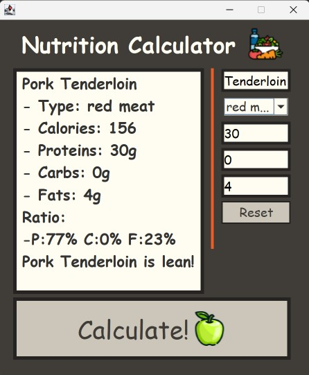

# Macronutrient Calculator GUI Project - Java Swing

    <strong>Project for students taking AP Computer Science A.</strong>

 

    Second-year programming students learn to code graphics in Java Swing.

 
 

In 2023, I had a really motivated class of AP CSA students that had all performed very well the year before in AP CS Principles in Python. After going over all of the logic in Java, I created this walkthrough project in Java Swing for them to get experience with building a graphic user interface and managing multiple files and folders. They would later be given project to create a GUI project of their own.
  
The GUI is a continuation of a macronutrient project done earlier in the year when students learn about Object-Oriented programming. Students will already have gained familiarity with how to store food data as an object and how to calculate calories from those fields. 

     

## What Is Learned:

- How to design an app in Java Swing to solve a real-world problem or necessity.
- How to design the color scheme and layout of an app in Java Swing.
- Using text fields in Java Swing to intake data, run calculations on the data, and reproduce the new data as output on screen.
- Managing project complexity by using functions and files to organize the design of the project.

  

## How to Use:

- The macronutrient calculator can be ran out of FoodGUI.java.
- Enter a food name, select a food type, and fill in the food's protein, carbs, and fats per serving in grams, and press calculate.
- The fields will create a "Food" object (Food.java) which has a field for each data field, and runs calculations to produce the number of calories from each field. It then generates a break down of the food's calories in proteins, carbs, and fats.
- The food item is considered "lean" if the calories contain:
  - cals &le; 25% fats **and** cals &ge; 35% proteins **and** 30% &le; cals &le; 65% carbs
  - _or_
  - cals &ge; 60% protein
